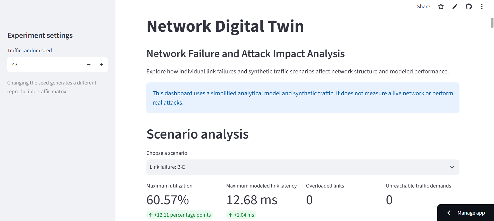

# Network Digital Twin for Network Failure and Attack Impact Analysis

A Python-based Network Digital Twin research project for analyzing network failures, traffic anomalies, attack scenarios, and their impact on network performance through simulation and experimental evaluation.

## 🚀 Live Dashboard

**[Launch the Network Digital Twin Dashboard](https://network-digital-twin-research.streamlit.app/)**

Explore the deployed application to view network scenarios, experiment results, performance analysis, and traffic sensitivity results.

## 📸 Dashboard Preview



## ✨ Key Features

- Network topology visualization.
- Network failure and attack scenario analysis.
- Traffic sensitivity experiments.
- Network performance and impact analysis.
- Statistical summaries of repeated experiments.
- Interactive dashboard for exploring experiment results.
- CSV downloads for sensitivity experiment data and summary results.

## 🛠️ Technology Stack

- **Language:** Python
- **Dashboard:** Streamlit
- **Network Modeling:** NetworkX
- **Data Analysis:** Pandas, SciPy
- **Visualization:** Matplotlib, Altair
- **Testing:** Pytest

## ⚙️ Run Locally

1. Clone the repository:

   ```bash
   git clone https://github.com/coralpixel/network-digital-twin-research.git
   cd network-digital-twin-research
   ```

2. Create and activate a virtual environment.

   **Windows PowerShell:**

   ```powershell
   python -m venv .venv
   .venv\Scripts\Activate.ps1
   ```

3. Install dependencies:

   ```bash
   pip install -r requirements.txt
   ```

4. Launch the dashboard:

   ```bash
   python -m streamlit run app/streamlit_app.py
   ```

## 🧪 Testing

Run the test suite using:

```bash
python -m pytest -v
```

## 📊 Research Focus

The project investigates how network failures, attack scenarios, and changing traffic loads affect network behavior and performance. Experimental results and statistical summaries support the analysis of network conditions and their impact.

## 🔗 Links

- **Live Dashboard:** https://network-digital-twin-research.streamlit.app/
- **GitHub Repository:** https://github.com/coralpixel/network-digital-twin-research
